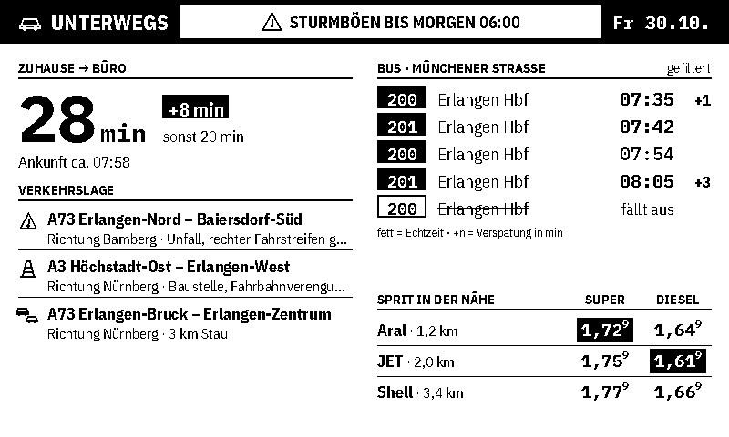
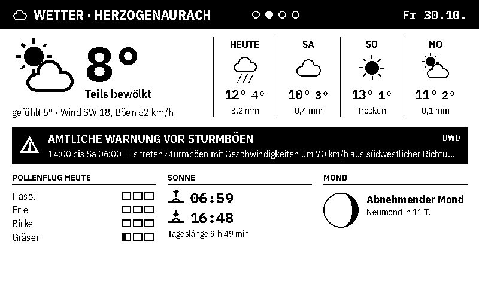
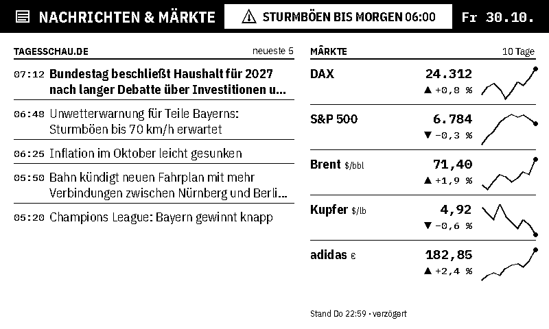
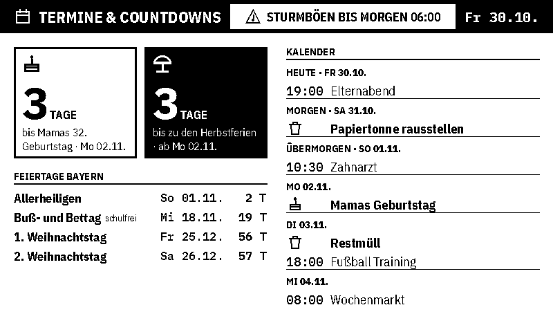

# Infotafel – 7,5"-e-Paper mit ESP32

Infodisplay für das **Waveshare 7.5inch e-Paper V2 (800×480, schwarz/weiß)**.
Der Homeserver holt alle Daten und zeichnet die Bilder; der ESP32 lädt nur noch
das fertige Bild, zeigt es an und schläft.

```
 Homeserver (Docker oder systemd)                     ESP32 + e-Paper
 python -m infotafel serve                            aufwachen, WLAN
   Daten holen (Cache, Hintergrund)  ── GET /image.bin ──▶  If-None-Match: <ETag>
   Ansicht nach Zeitplan zeichnen    ◀── 200 + 48000 Bytes   neu zeichnen
                                     ◀── 304 (unverändert)   Display in Ruhe lassen
                                         X-Sleep-Seconds  ─▶ Tiefschlaf
```

## Ansichten

| Unterwegs | Wetter |
|---|---|
|  |  |
| **Nachrichten & Märkte** | **Termine & Countdowns** |
|  |  |

(Beispieldaten, erzeugt mit `python -m infotafel preview --demo`.)

* **Unterwegs:** Fahrtzeit Zuhause → Büro mit Abweichung zur üblichen Fahrzeit,
  Verkehrsmeldungen im Umkreis (A73, A3 …), Busabfahrten Münchener Straße
  (gefiltert nach Linien/Richtungen, als Uhrzeit), Spritpreise.
* **Wetter:** aktuell + 4 Tage, amtliche DWD-Warnung, Pollenflug, Sonnenauf-/
  -untergang, Mondphase.
* **Nachrichten & Märkte:** tagesschau-Schlagzeilen, Indizes/Rohstoffe/Aktien
  mit 10-Tage-Verlauf.
* **Termine & Countdowns:** nächster Geburtstag, Ferien-Countdown, Feiertage in
  Bayern, Kalender der nächsten 7 Tage (inkl. Müllabfuhr und Geburtstagen).

Eine **aktive Unwetterwarnung** erscheint in jeder Ansicht in der Kopfzeile.
Ein `!` vor dem Datum heißt: Mindestens eine Quelle dieser Ansicht konnte zuletzt
nicht aktualisiert werden (es werden die letzten Daten gezeigt).

## Zeitplan und Refreshs

* Die Ansichten wechseln alle `interval_minutes` (Standard 5, mindestens 3 –
  Waveshare empfiehlt ≥ 180 s zwischen zwei Refreshs).
* **Regeln** (z. B. werktags 6:30–8:30 nur „Unterwegs“ und „Wetter“ im 3-Minuten-Takt).
* **Nachtruhe** 22–6 Uhr: feste Ansicht (Termine). Der ESP32 fragt alle 30 Minuten
  nach, gezeichnet wird aber nur, wenn sich das Bild geändert hat – praktisch nur
  um Mitternacht (neues Datum) oder bei einer schweren Unwetterwarnung (dann
  zeigt die Nacht die Wetter-Ansicht).
* **Nur bei Änderung neu zeichnen:** Der Server schickt einen ETag (Prüfsumme des
  Bildes). Ist das Bild gleich, antwortet er mit 304 und das Display bleibt
  unangetastet. Deshalb steht in der Kopfzeile auch keine Uhrzeit.
* Der Server entscheidet alles; Zeitplan-Änderungen brauchen kein neues Flashen.

## 1. Server einrichten

### Konfiguration

```sh
git clone https://github.com/mohnstollen/epi.git
cd epi/7in5
cp config.example.toml config.toml   # Orte, Linien, Kurse, Geburtstage …
cp .env.example .env                 # API-Keys und private Kalender-Links
```

`config.toml` und `.env` sind in der `.gitignore`. In der `config.toml` werden
Geheimnisse als `"${NAME}"` referenziert und aus der `.env` eingesetzt.

**Haltestellen-ID** für die Münchener Straße suchen und in `transit.stop_id` eintragen:

```sh
python -m infotafel haltestelle "Herzogenaurach Münchener"
```

### Starten mit Docker (empfohlen)

```sh
docker compose up -d --build
docker compose logs -f
```

### Oder ohne Docker

```sh
python3 -m venv .venv
.venv/bin/pip install -r requirements.txt
.venv/bin/python -m infotafel serve --config config.toml
```

Als Dienst: `infotafel.service` anpassen (User, Pfade) und nach
`/etc/systemd/system/` kopieren. Benötigt Python ≥ 3.11.

### Prüfen

```sh
python -m infotafel check                 # alle Quellen einmal abrufen, Fehler anzeigen
python -m infotafel preview               # alle Ansichten als PNG nach preview/
python -m infotafel preview --demo --at 2026-10-30T07:30   # mit Beispieldaten
```

Im Browser: `http://<homeserver>:8080/` zeigt alle Ansichten, die aktuell
geplante und den Zustand aller Datenquellen. `/status.json` liefert dasselbe als JSON.

Dem Homeserver im Router eine feste IP geben (DHCP-Reservierung), damit der ESP32
ihn findet.

## 2. ESP32 flashen

Firmware: `firmware/infotafel/`

1. `firmware/infotafel/config.example.h` nach `config.h` kopieren, WLAN und
   `SERVER_URL` eintragen.
2. Bauen und flashen:
   * **PlatformIO:** `cd firmware && pio run -t upload && pio device monitor`
   * **Arduino IDE:** Boardverwalter „esp32“ (Espressif), Bibliothek **GxEPD2**,
     Ordner `firmware/infotafel` öffnen, Board „ESP32 Dev Module“, hochladen.
3. Serieller Monitor (115200 Baud) zeigt WLAN, HTTP-Status, Ansicht und Schlafdauer.

**Hardware:** Standard sind die Pins des Waveshare *Universal e-Paper Raw Panel
Driver Board* (ESP32, Display per Flachbandkabel; Schalter auf „B“). Für einen
ESP32-DevKit mit e-Paper-HAT stehen die Pins auskommentiert in `config.example.h`.

Bleibt das Display leer oder ist das Bild gestört: in `config.h`
`#define PANEL_GDEY075T7` aktivieren (neuere V2-Panels nutzen einen anderen
Controller-Typ).

Ist der Server nicht erreichbar, bleibt das letzte Bild stehen; der ESP32
versucht es nach 1, 2, 4, 8, 15 Minuten erneut.

## Datenquellen

| Quelle | Daten | Key |
|---|---|---|
| [Open-Meteo](https://open-meteo.com/en/docs/dwd-api) (DWD ICON) | Wetter, Sonne | – |
| [Bright Sky](https://brightsky.dev) | DWD-Unwetterwarnungen | – |
| [DWD Open Data](https://opendata.dwd.de/climate_environment/health/alerts/) | Pollenflug-Gefahrenindex | – |
| [Tankerkönig](https://creativecommons.tankerkoenig.de) | Spritpreise (MTS-K, CC BY 4.0) | ja |
| start.vag.de (VGN) oder v6.db.transport.rest | Abfahrten | – |
| [TomTom](https://developer.tomtom.com) | Fahrtzeit, optional Meldungen abseits der Autobahn | ja (frei) |
| [Autobahn GmbH](https://autobahn.api.bund.dev) | Warnungen, Sperrungen | – |
| tagesschau.de RSS | Schlagzeilen | – |
| Yahoo Finance (inoffiziell) | Kurse, verzögert | – |
| ICS-Links | Kalender, Abfuhrtermine | – |
| [OpenHolidays](https://openholidaysapi.org) | Schulferien Bayern | – |

Feiertage in Bayern und die Mondphase werden lokal berechnet.
Schrift: IBM Plex Sans Condensed / Plex Mono (SIL Open Font License, `infotafel/fonts/OFL.txt`).

**Hinweis:** Die VGN-Abfahrts-API und Yahoo Finance sind nicht offiziell
dokumentiert und können sich ändern. Fällt eine Quelle aus, zeigen die anderen
Bereiche weiter ihre Daten. `python -m infotafel check` hilft bei der Fehlersuche.

## Entwicklung

```sh
python -m unittest discover -s tests -t .
```

```
infotafel/
  __main__.py     Kommandozeile (serve, preview, check, haltestelle)
  config.py       config.toml + .env laden, prüfen
  schedule.py     welche Ansicht wann, Schlafdauer, Nachtruhe
  app.py          Bild + Displaypuffer erzeugen
  server.py       HTTP-Server (ETag/304, Vorschau, Status)
  render.py       Schriften, Kopfzeile, Textumbruch
  icons.py        Wetter-Icons und Symbole
  views/          die vier Ansichten
  sources/        Datenquellen (weather, mobility, info) + Cache
  demo.py         Beispieldaten
firmware/         ESP32 (Arduino/PlatformIO)
```
