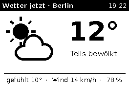
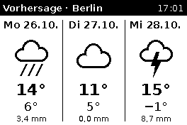
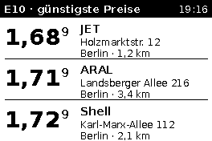
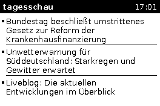
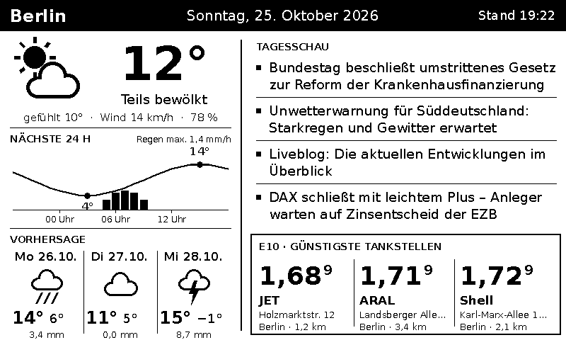

# E-Paper-Dashboard für Raspberry Pi

Dashboard mit Wetter (DWD ICON-D2), E10-Spritpreisen (Tankerkönig) und
tagesschau-Schlagzeilen für zwei Waveshare-e-Paper-Displays (schwarz/weiß).
Welches Display angeschlossen ist, wird in `config.toml` mit `display` gewählt.

### `display = "2in7"` – 2.7inch e-Paper HAT Rev2.1 (264×176)

Alle 3 Minuten wechselt die Anzeige zwischen vier Ansichten:

| # | Ansicht | Quelle |
|---|---------|--------|
| 1 | Aktuelles Wetter: großes Icon, Temperatur, Beschreibung, gefühlte Temperatur, Wind, Luftfeuchte | DWD ICON-D2 |
| 2 | Vorhersage der kommenden 3 Tage (ab morgen): Icon, max./min. Temperatur, Niederschlag | DWD ICON-D2 + ICON-EU |
| 3 | E10-Preise der 3 günstigsten geöffneten Tankstellen, aufsteigend nach Preis | Tankerkönig |
| 4 | Aktuelle Schlagzeilen – so viele, wie gut lesbar passen (meist 3–4, max. 5) | tagesschau RSS |

 
 

### `display = "7in5"` – 7.5inch e-Paper HAT V2 (800×480, Querformat)

Alles auf einer Seite, aktualisiert alle 10 Minuten:

* **links:** aktuelles Wetter, Temperaturkurve der nächsten 24 Stunden mit
  Regenbalken (stündliche ICON-D2-Werte), Vorhersage für 3 Tage
* **rechts:** tagesschau-Schlagzeilen (je max. 2 Zeilen) und darunter die drei
  günstigsten E10-Tankstellen nebeneinander



## Datenquellen

* **Wetter:** Die Rohdaten des DWD liegen als GRIB2-Dateien vor, deren
  Verarbeitung einen Pi 2 überfordern würde. Daher werden die ICON-Daten über
  die [DWD-Schnittstelle von Open-Meteo](https://open-meteo.com/en/docs/dwd-api)
  abgerufen (kostenlos, kein Key, Lizenz CC BY 4.0).
  Das aktuelle Wetter und die 24-Stunden-Kurve kommen direkt aus **ICON-D2**
  (`models=icon_d2`).
  ICON-D2 rechnet nur ca. 48 Stunden voraus; für den dritten Tag der Vorhersage
  wird deshalb `icon_seamless` genutzt, das ICON-D2 verwendet, solange es
  Daten gibt, und danach mit ICON-EU des DWD ergänzt.
* **Spritpreise:** [Tankerkönig-API](https://creativecommons.tankerkoenig.de)
  (`list.php`, Sorte `e10`, Sortierung nach Preis). Es werden nur geöffnete
  Tankstellen berücksichtigt. Abfrage höchstens alle 5 Minuten, wie von
  Tankerkönig gefordert. Daten: MTS-K, Lizenz CC BY 4.0.
* **Nachrichten:** `https://www.tagesschau.de/xml/rss2/`

Schlägt ein Abruf fehl, bleiben die zuletzt geladenen Daten stehen und in der
Kopfzeile erscheint ein `!` vor der Uhrzeit.

## Installation auf dem Raspberry Pi

1. SPI aktivieren: `sudo raspi-config` → *Interface Options* → *SPI* → *Yes*,
   danach neu starten.
2. Abhängigkeiten installieren:
   ```sh
   sudo apt update
   sudo apt install git python3-pil python3-spidev python3-gpiozero python3-lgpio fonts-dejavu-core
   ```
   (Benötigt Python ≥ 3.11, also Raspberry Pi OS *Bookworm* oder neuer.)
3. Projekt holen und konfigurieren:
   ```sh
   cd ~
   git clone <repo-url> epi
   cd epi
   cp config.example.toml config.toml
   nano config.toml   # Standort und Tankerkönig-API-Key eintragen
   ```
   Den kostenlosen API-Key gibt es unter
   <https://onboarding.tankerkoenig.de>.
4. Testen:
   ```sh
   python3 -m dashboard --preview preview      # Ansichten als PNG, ohne Display
   python3 -m dashboard                         # aufs Display (Strg+C beendet)
   ```
   `--demo` verwendet Beispieldaten statt Online-Abruf, `--display 7in5`
   überschreibt das Display aus der Konfiguration.
5. Als Dienst einrichten (startet automatisch beim Booten):
   ```sh
   sudo cp epaper-dashboard.service /etc/systemd/system/
   # ggf. User und Pfade in der Datei anpassen
   sudo systemctl daemon-reload
   sudo systemctl enable --now epaper-dashboard
   journalctl -u epaper-dashboard -f            # Log ansehen
   ```

## Variante: ESP32 als Anzeige, Raspberry Pi als Bildserver

Statt das Display direkt am Pi zu betreiben, kann ein ESP32 die Anzeige
übernehmen. Der Pi ruft weiter alle Daten ab und rendert das Bild; der ESP32
lädt es per WLAN, zeigt es an und schläft bis zum nächsten Wechsel.

```
 Raspberry Pi                                   ESP32 + e-Paper
 python3 -m dashboard --serve   ── WLAN/LAN ──▶  GET /image.bin
 (Daten holen, Bild rendern)    ◀── 48000 Bytes  anzeigen, Tiefschlaf
```

### Pi: Server einrichten

1. Installation wie oben (Schritte 2 und 3). SPI, `spidev` und `gpiozero`
   werden für den Server nicht gebraucht. In `config.toml` bei `display`
   das Display eintragen, das am **ESP32** hängt.
2. Testen: `python3 -m dashboard --serve` und im Browser
   `http://<IP-des-Pi>:8080/` öffnen – dort erscheint das aktuelle Bild.
3. Als Dienst einrichten (statt `epaper-dashboard.service`):
   ```sh
   sudo cp epaper-server.service /etc/systemd/system/
   sudo systemctl daemon-reload
   sudo systemctl enable --now epaper-server
   ```
4. Dem Pi im Router eine feste IP-Adresse geben (DHCP-Reservierung), damit
   der ESP32 ihn immer findet.

Endpunkte: `/image.bin` (Rohdaten fürs Display, Header `X-Next-Refresh` =
Sekunden bis zum nächsten Wechsel), `/image.png` und `/` zur Kontrolle.
Beim 2.7"-Display bestimmt die Uhrzeit, welche der vier Ansichten dran ist;
Pi und ESP32 bleiben so ohne Abstimmung im Takt.

### ESP32: Firmware

Die Firmware liegt in `esp32/epaper_dashboard/`.

1. `esp32/epaper_dashboard/config.example.h` nach `config.h` kopieren und
   WLAN, `SERVER_URL` (IP des Pi), Display und Pins eintragen.
2. Bauen und flashen – eine der beiden Möglichkeiten:
   * **Arduino IDE:** Boardverwalter „esp32“ (Espressif) installieren,
     Bibliothek **GxEPD2** installieren, Ordner `epaper_dashboard` öffnen,
     Board „ESP32 Dev Module“ wählen, hochladen.
   * **PlatformIO:** `cd esp32 && pio run -t upload && pio device monitor`
3. Im seriellen Monitor (115200 Baud) sieht man WLAN-Verbindung, Download
   und Schlafdauer.

Verkabelung (HAT-Kabel → ESP32-DevKit, änderbar in `config.h`):

| HAT | VCC | GND | DIN | CLK | CS | DC | RST | BUSY | PWR (nur Rev2.3) |
|-----|-----|-----|-----|-----|----|----|-----|------|------------------|
| ESP32 | 3V3 | GND | 23 | 18 | 5 | 17 | 16 | 4 | 22 |

Für das Waveshare „Universal e-Paper Driver Board“ mit ESP32 stehen die
passenden Pins auskommentiert in `config.example.h`.

Ist der Pi nicht erreichbar, bleibt das letzte Bild stehen und der ESP32
versucht es nach einer Minute erneut.

## Konfiguration (`config.toml`)

| Schlüssel | Bedeutung | Standard |
|-----------|-----------|----------|
| `latitude`, `longitude` | Standort in Dezimalgrad | – |
| `location_name` | Ortsname in der Kopfzeile | leer |
| `tankerkoenig_api_key` | API-Key von Tankerkönig | – |
| `fuel_radius_km` | Suchradius für Tankstellen (max. 25) | 5 |
| `display` | `"2in7"` oder `"7in5"` | `"2in7"` |
| `interval_seconds` | Wechsel- bzw. Aktualisierungsintervall | 180 / 600 |
| `rotate180` | Bild um 180° drehen, falls es auf dem Kopf steht | false |
| `max_headlines` | Höchstzahl Schlagzeilen | 5 |
| `timezone` | Zeitzone für die Wetterdaten | Europe/Berlin |

## Hinweise zur Hardware

* Die beiliegenden Treiber in `dashboard/epd.py` (2.7inch Rev2.1/V2 und
  7.5inch V2) brauchen nur `spidev` und `gpiozero`; die Waveshare-Bibliothek
  muss nicht installiert werden.
* Verkabelung (BCM): RST 17, DC 25, BUSY 24, CS = CE0 (GPIO 8), CLK 11,
  DIN 10, PWR 18 (nur Driver HAT Rev2.3) – entspricht der Belegung beim
  Aufstecken auf die Stiftleiste.
* Beim 7.5inch Driver HAT muss der Interface-Schalter auf **0 (4-line SPI)**
  stehen, „Display Config“ normalerweise auf **B (0.47R)**. Bleibt das Bild
  blass oder fehlerhaft, „A (3R)“ ausprobieren.
* Es wird bei jedem Wechsel eine Vollaktualisierung (kurzes Flackern) gemacht;
  dazwischen schläft das Display. Das Bild bleibt auch ohne Strom stehen.

## Projektstruktur

```
dashboard/
  __main__.py     Hauptschleife, CLI (--config, --preview, --demo)
  sources.py      Abruf von Wetter, Spritpreisen, Schlagzeilen + Cache
  screens.py      Layout der vier Ansichten (2.7")
  layout7in5.py   Ein-Seiten-Layout (7.5")
  icons.py        Wetter-Icons (mit PIL gezeichnet) und Beschreibungen
  epd.py          Displaytreiber, Pufferformat
  server.py       HTTP-Bildserver für den ESP32 (--serve)
  demo.py         Beispieldaten
esp32/
  epaper_dashboard/   ESP32-Firmware (Arduino IDE / PlatformIO)
  platformio.ini
```

